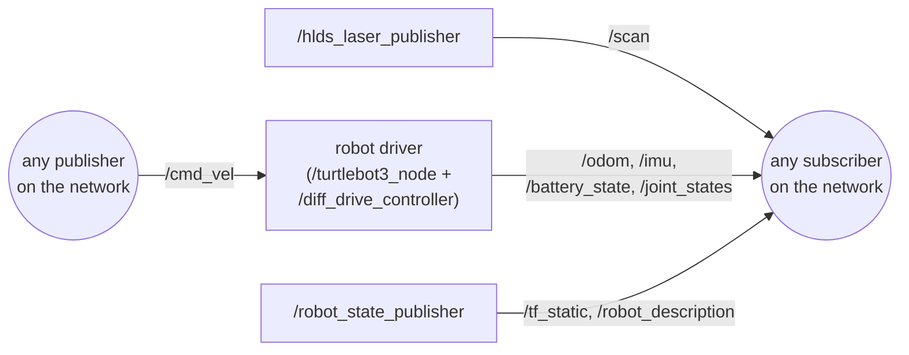

# Chapter 04: Bringing up the robot

> **Command tags:** `[Pi]` = SSH session on the robot, `[PC]` = normal PC terminal,
> `[PC-container]` = inside the Docker container on the PC.

## Goal

Start the robot's software on the Pi, then look inside it: which **nodes** are running, which
**topics** they use, and what data is flowing.

## ROS concepts in this chapter

This is the chapter where ROS 2 stops being abstract.

| Concept | What it is here | How to see it yourself |
|---------|-----------------|------------------------|
| **Node** | A small program that does one job. The lidar driver is a node. So is the robot driver | `ros2 node list` |
| **Launch file** | A script that starts several nodes together. `robot.launch.py` starts everything the robot needs | `ros2 launch turtlebot3_bringup robot.launch.py` |
| **Topic** | A named channel that carries one kind of data, such as `/scan` for lidar | `ros2 topic list -t` |
| **Publisher** | A node that **sends** messages on a topic. The lidar node publishes on `/scan` | `ros2 topic info /scan -v` |
| **Subscriber** | A node that **receives** messages from a topic. The robot driver subscribes to `/cmd_vel` | `ros2 topic info /cmd_vel -v` |
| **Message type** | The shape of the data on a topic, such as `sensor_msgs/msg/LaserScan` | `ros2 interface show sensor_msgs/msg/LaserScan` |

A radio makes a good picture of this. A **topic** is a radio channel. A **publisher** is a
station broadcasting on it. A **subscriber** is a radio tuned to it. The station does not know
or care who is listening, and many radios can listen to one station. That is why a node on your
PC can listen to a node on the robot without the robot knowing anything about the PC.

## Before you start

- [ ] Chapter 02 is done and you can SSH into the Pi
- [ ] The robot is powered, the battery is charged, and the OpenCR board and lidar are connected to the Pi
- [ ] The robot is on the floor with space around it, or its wheels are lifted

## Steps

### Step 4.1: Open two SSH sessions to the Pi

Open two terminal windows on the PC and log in to the Pi in both:

```bash
# [PC]  (run in each window)
ssh ubuntu@<PI_IP>
```

Window 1 runs the robot software and stays busy. Window 2 is for looking around.

### Step 4.2: Start the robot software

In window 1:

```bash
# [Pi]  window 1
source /opt/ros/humble/setup.bash
export TURTLEBOT3_MODEL=waffle_pi
export LDS_MODEL=LDS-01
ros2 launch turtlebot3_bringup robot.launch.py
```

`TURTLEBOT3_MODEL` and `LDS_MODEL` tell the launch file which robot and which lidar you have.
Use your own values (`burger` or `waffle_pi`, and `LDS-01` or `LDS-02`).

**You should see:** log lines from several nodes starting, with no red `ERROR` lines.
**Leave this terminal running.** Press `Ctrl+C` in it to stop the robot software.

### Step 4.3: List the nodes

In window 2:

```bash
# [Pi]  window 2
source /opt/ros/humble/setup.bash
ros2 node list
```

**You should see** (this is what my robot showed):

```text
/diff_drive_controller
/hlds_laser_publisher
/robot_state_publisher
/turtlebot3_node
```

| Node | Its job |
|------|---------|
| `/turtlebot3_node` | The main robot driver. It talks to the OpenCR board: motors, IMU, battery |
| `/diff_drive_controller` | The differential-drive logic: velocity commands in, wheel motion and odometry out |
| `/hlds_laser_publisher` | The driver for the LDS-01 lidar (it publishes the laser scans) |
| `/robot_state_publisher` | Reads the robot's 3D model and wheel positions and publishes where each part is |

### Step 4.4: List the topics

```bash
# [Pi]  window 2
ros2 topic list -t
```

The `-t` adds each topic's message type. **You should see:**

```text
/battery_state [sensor_msgs/msg/BatteryState]
/cmd_vel [geometry_msgs/msg/Twist]
/imu [sensor_msgs/msg/Imu]
/joint_states [sensor_msgs/msg/JointState]
/magnetic_field [sensor_msgs/msg/MagneticField]
/odom [nav_msgs/msg/Odometry]
/parameter_events [rcl_interfaces/msg/ParameterEvent]
/robot_description [std_msgs/msg/String]
/rosout [rcl_interfaces/msg/Log]
/scan [sensor_msgs/msg/LaserScan]
/sensor_state [turtlebot3_msgs/msg/SensorState]
/tf [tf2_msgs/msg/TFMessage]
/tf_static [tf2_msgs/msg/TFMessage]
```

What they mean:

| Topic | What it carries | Used later in |
|-------|-----------------|---------------|
| `/scan` | Distances to obstacles all around the robot, from the lidar | 10, 12 (mapping and navigation) |
| `/odom` | The robot's estimated position, calculated from wheel movement | 10, 12 |
| `/cmd_vel` | **Commands going in:** how fast to drive and turn | 06 (teleop), 12 |
| `/tf`, `/tf_static` | Where each coordinate frame (robot body, lidar, wheels) is | 08 |
| `/imu` | Rotation and acceleration from the OpenCR board's motion sensor | |
| `/magnetic_field` | Magnetometer readings | |
| `/battery_state` | Battery voltage and status | 13 |
| `/joint_states` | How far each wheel has turned | |
| `/sensor_state` | Raw readings from the OpenCR board (a TurtleBot3-specific message type) | |
| `/robot_description` | The robot's 3D model, as text | |
| `/parameter_events`, `/rosout` | Housekeeping topics that exist in every ROS 2 system (parameter changes and log messages) | |

Notice that most topics are data coming **out** of the robot (sensors), and `/cmd_vel` is the
main way data goes **in**.

### Step 4.5: See who publishes and who subscribes

```bash
# [Pi]  window 2
ros2 topic info /scan -v
ros2 topic info /cmd_vel -v
ros2 topic info /odom -v
```

The output lists each **publisher** and **subscriber** by node name, with their settings. Look
for the node names from Step 4.3. You should find `/hlds_laser_publisher` publishing `/scan`,
and a robot node subscribing to `/cmd_vel`.

> **Quality of Service (QoS):** `-v` also prints a QoS block with *Reliability* and *Durability*.
> This describes how a topic treats lost or late messages. For now it is enough to know it
> exists. It matters when a display (like RViz) shows nothing even though the topic has data,
> because a publisher and a subscriber with incompatible QoS settings cannot talk to each other.

Here is how the main pieces connect:



### Step 4.6: Look at the actual data

```bash
# [Pi]  window 2
ros2 topic echo /battery_state --once
ros2 topic hz /scan
```

Press `Ctrl+C` to stop `hz`. **You should see:**

- `echo`: a message with a `voltage` field. It should be near your battery's rated voltage.
  If it is below about 11 V, recharge before going on.
- `hz`: the average rate of `/scan`. The LDS-01 lidar completes about 5 turns per second, so
  expect roughly 5 Hz.

Then look at what a **message type** really is:

```bash
# [Pi]  window 2
ros2 interface show geometry_msgs/msg/Twist
```

A `Twist` is two groups of three numbers: `linear` (x, y, z) and `angular` (x, y, z). For a
ground robot only `linear.x` (forward speed) and `angular.z` (turning speed) matter. In Chapter 06
you will publish exactly this message to make the robot move.

## Checklist

- [ ] `ros2 launch turtlebot3_bringup robot.launch.py` runs with no red errors
- [ ] `ros2 node list` shows the four nodes
- [ ] `ros2 topic list -t` shows `/scan`, `/odom`, `/cmd_vel` and `/tf`
- [ ] `ros2 topic hz /scan` shows a steady rate
- [ ] `/battery_state` shows a sensible voltage
- [ ] You can explain in your own words what a node, a topic, a publisher and a subscriber are

## Heads-up: something I ignored here

Nothing visibly failed in this chapter. But at this point the Pi's clock was wrong (it showed a
date months in the past), and ROS did not complain. I wrote it down as "fix later". That clock
caused the "No transform" problems in [Chapter 08](08-no-transform-and-the-clock.md). If you can,
check `date` on the Pi now, and save yourself that detour.

## Recap

- You started the robot with one **launch file** and saw four **nodes** appear.
- You listed the **topics** and their **message types**, and saw which carry data out (`/scan`, `/odom`) and which carry commands in (`/cmd_vel`).
- You used the idea of **publishers and subscribers**: the sender never needs to know who is listening.
- Next: see these same topics from your PC, inside Docker.

## Try it yourself (optional)

Run `ros2 topic hz /odom` and `ros2 topic hz /scan`. Why might the rates be different? Then run
`ros2 topic echo /scan --once` and find the `ranges` field. How many numbers does it contain?
