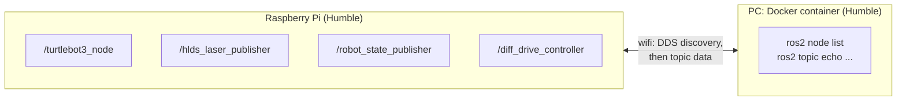

# Chapter 05: Two machines, one ROS graph

> **Command tags:** `[Pi]` = SSH session on the robot, `[PC]` = normal PC terminal,
> `[PC-container]` = inside the Docker container on the PC.

## Goal

See the robot's nodes and topics from a container on your PC, without installing or
configuring anything on either side, and understand **why** that works.

## ROS concepts in this chapter

| Concept | What it is here | How to see it yourself |
|---------|-----------------|------------------------|
| **ROS graph** | All the nodes and topics that can currently see each other, on any machine | `ros2 node list` and `ros2 topic list` |
| **DDS discovery** | How nodes find each other. ROS 2 is built on DDS, a networking layer in which every node announces itself on the network and listens for others. There is no central server | Start the robot software on the Pi and watch your PC's topic list fill up |
| **Domain ID** | A number (default `0`). Nodes only see each other if they use the same one | `printenv ROS_DOMAIN_ID` (empty means `0`) |
| **`ROS_LOCALHOST_ONLY`** | When set to `1`, a node talks only to nodes on its own machine. It must be `0` to reach another computer | `printenv ROS_LOCALHOST_ONLY` |
| **Middleware (RMW)** | The DDS implementation ROS 2 uses underneath. Both machines should use the same one. Humble uses Fast DDS by default | `printenv RMW_IMPLEMENTATION` (empty means the default) |

The big idea: in ROS 2 there is **no master node** that everything has to register with (ROS 1
had one). Every node announces itself, listens for others, and connects to them directly. So a
node in a container on your PC can use a topic published by a node on the Pi as if both were on
one machine.

## Before you start

- [ ] Chapter 03 is done: you have the container `tb3_pc` (in my case, I named it `tb3_pc_gui`)
- [ ] Chapter 04 is done: you can start the robot software on the Pi
- [ ] The Pi and the PC are on the same network (Chapter 02)

## Steps

### Step 5.1: Check the two machines can reach each other

```bash
# [PC]
ping -c 3 <PI_IP>
```

```bash
# [Pi]
ping -c 3 <PC_IP>
```

Find `<PC_IP>` with `hostname -I` on the PC. Both pings should get replies. If not, go back to
Chapter 02 before continuing.

### Step 5.2: Start the robot software on the Pi

```bash
# [Pi]
source /opt/ros/humble/setup.bash
export TURTLEBOT3_MODEL=waffle_pi
export LDS_MODEL=LDS-01
ros2 launch turtlebot3_bringup robot.launch.py
```

Leave it running.

### Step 5.3: Open a shell in the container

```bash
# [PC]
docker start tb3_pc_gui
docker exec -it tb3_pc_gui bash
```

`docker start` brings the stopped container back, and `docker exec` opens a terminal inside it.
If you set up `~/.bashrc` as in Chapter 03, ROS is already loaded. If not, run
`source /opt/ros/humble/setup.bash`.

### Step 5.4: Look at the robot from the container

```bash
# [PC-container]
ros2 node list
ros2 topic list
```

**You should see** (this is what my container showed, while the robot software ran on the Pi):

```text
/diff_drive_controller
/hlds_laser_publisher
/robot_state_publisher
/turtlebot3_node
```

```text
/battery_state
/cmd_vel
/imu
/joint_states
/magnetic_field
/odom
/parameter_events
/robot_description
/rosout
/scan
/sensor_state
/tf
/tf_static
```

These are exactly the four nodes and the topics from Chapter 04. **None of them run on the PC.**
The container found them over wifi, with no setup beyond `--network host` (Chapter 03).

### Step 5.5: Prove the data is real, not just names

```bash
# [PC-container]
ros2 topic hz /scan
ros2 topic echo /battery_state --once
```

The rate of `/scan` should be about what you saw on the Pi in Chapter 04. In my case the output was:

```bash
average rate: 4.226
        min: 0.104s max: 0.308s std dev: 0.09075s window: 6
average rate: 4.484
        min: 0.001s max: 0.400s std dev: 0.12033s window: 11
average rate: 4.355
        min: 0.001s max: 0.410s std dev: 0.11807s window: 16
```
Stop `hz` with `Ctrl+C`.

The output of `/battery_state` should print a message like:

```bash
header:
  stamp:
    sec: 1792053141
    nanosec: 55147299
  frame_id: ''
voltage: 12.369999885559082
temperature: 0.0
current: 0.0
charge: 0.0
capacity: 0.0
design_capacity: 1.7999999523162842
percentage: 103.87999725341797
power_supply_status: 0
power_supply_health: 0
power_supply_technology: 0
present: true
cell_voltage: []
cell_temperature: []
location: ''
serial_number: ''
```

### Step 5.6 (optional): Watch the graph shrink

In the Pi's bringup terminal, press `Ctrl+C`. Then, in the container:

```bash
# [PC-container]
ros2 node list
ros2 topic list
```

After a few seconds the robot's nodes should disappear and only `/parameter_events` and
`/rosout` should remain. Those two exist in every ROS 2 system. Restart bringup on the Pi
when you are done.

> If the old nodes seem to stay for a while, the `ros2` command line tool is using a cached
> list. Run `ros2 daemon stop` and try again.

### Step 5.7: Check the environment on both sides

```bash
# [PC-container]
printenv | grep -E "ROS|RMW"
```

```bash
# [Pi]
printenv | grep -E "ROS|RMW"
```

**You should see** the same on both (mine did):

```text
ROS_VERSION=2
ROS_PYTHON_VERSION=3
ROS_LOCALHOST_ONLY=0
ROS_DISTRO=humble
```

There is no `ROS_DOMAIN_ID` and no `RMW_IMPLEMENTATION`, which means both machines use the
defaults: domain `0` and Fast DDS. Matching defaults is why this worked on the first try.

Here is the picture:



## Checklist

- [ ] The container shows the same four nodes as the Pi
- [ ] The container shows the same topics, including `/scan` and `/cmd_vel`
- [ ] `ros2 topic hz /scan` in the container shows a steady rate
- [ ] `ROS_LOCALHOST_ONLY` is `0` and `ROS_DOMAIN_ID` matches (or is unset) on both machines
- [ ] You can explain why no master node is needed in ROS 2

## When it broke

Nothing broke in this chapter. With matching defaults, discovery worked the first time. That is
good news, but if it had not, this is the checklist I would work through (general guidance, not
something I had to do on my robot):

| Symptom | Likely cause | What to check |
|---------|--------------|---------------|
| Container shows only `/parameter_events` and `/rosout` | Different domain ID, or `ROS_LOCALHOST_ONLY=1` | `printenv ROS_DOMAIN_ID ROS_LOCALHOST_ONLY` on both sides |
| Same, and the environment matches | Container not on the host network | The container must be started with `--network host` (Chapter 03). With Docker's default network, discovery usually does not reach the robot |
| Same, and the container is on the host network | Different networks, or a firewall blocking the traffic | `ping` both ways (Step 5.1), and `sudo ufw status` on the PC |
| Topics are listed but no data arrives | A network or wifi problem, or a QoS mismatch | `ros2 topic hz`, and `ros2 topic info -v` on both sides |
| Old nodes still listed after you stop the robot | Cached list in the ROS 2 command line tool | `ros2 daemon stop` |

## Recap

- You saw the robot's nodes and topics from a container on your PC, with no setup beyond host networking.
- You met the **ROS graph**, **DDS discovery**, the **domain ID** and `ROS_LOCALHOST_ONLY`.
- You learned that ROS 2 has no master: nodes find each other directly.
- Next: use this connection to **publish** to `/cmd_vel` and drive the robot.

## Try it yourself (optional)

From the container, run `ros2 node info /hlds_laser_publisher`. It lists the topics that node
publishes and subscribes to, on a machine that is not even running it. Do the same for
`/turtlebot3_node` and compare what it publishes with the list in Chapter 04.
