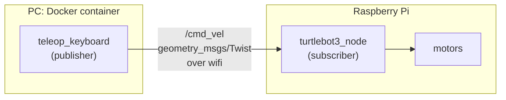

# Chapter 06: Driving the robot

> **Command tags:** `[Pi]` = SSH session on the robot, `[PC]` = normal PC terminal,
> `[PC-container]` = inside the Docker container on the PC.

## Goal

Make the robot move with the keyboard, first from the Pi and then from the container on your PC,
and see the publisher/subscriber idea work on real hardware.

## ROS concepts in this chapter

| Concept | What it is here | How to see it yourself |
|---------|-----------------|------------------------|
| **Publisher** | The `teleop_keyboard` node turns key presses into messages and publishes them on `/cmd_vel` | `ros2 topic info /cmd_vel -v` |
| **Subscriber** | `turtlebot3_node` receives those messages and drives the motors | the same command |
| **Message type: `Twist`** | A speed command: how fast to go forward and how fast to turn | `ros2 interface show geometry_msgs/msg/Twist` |
| **Pub/sub across machines** | The publisher can run on the PC while the subscriber runs on the Pi. Neither needs to know where the other is | Step 6.6 |
| **QoS** | The `/cmd_vel` connection uses *Reliable* delivery and *Volatile* durability | `ros2 topic info /cmd_vel -v` |

A `Twist` has two parts, each with x, y and z:

- `linear`: how fast to move. For a ground robot only `linear.x` (forward speed, in metres per second) matters.
- `angular`: how fast to rotate. Only `angular.z` (turning speed, in radians per second) matters.

## Before you start

- [ ] Chapter 05 is done: the container can see the robot's topics
- [ ] The robot software is running on the Pi (Chapter 04)
- [ ] **The robot's wheels are lifted off the ground**, or it is on the floor with clear space and you are next to it

## Steps

### Step 6.1: Start teleop on the Pi

```bash
# [Pi]  new SSH window
source /opt/ros/humble/setup.bash
export TURTLEBOT3_MODEL=waffle_pi
ros2 run turtlebot3_teleop teleop_keyboard
```

Keep this window focused. The keys only work while it is selected.

### Step 6.2: Learn the keys

| Key | What it does |
|-----|--------------|
| `w` / `x` | **Increase / decrease** the forward speed |
| `a` / `d` | **Increase / decrease** the turning speed (left / right) |
| `s` or space | **Stop**: speeds go back to zero |
| `Ctrl+C` | Quit teleop |

Important: the keys **change the speed in small steps**. They do not mean "move while I hold the
key". If you press `w` five times, the robot drives at five steps of speed and **keeps driving
until you press `s`**. On my robot, forward speed changed in steps of 0.01 m/s and turning speed
in steps of 0.1 rad/s. The Waffle Pi tops out at about 0.26 m/s forward and 1.82 rad/s turning.

Teleop prints the current speeds as you press keys, for example:

```text
currently:      linear velocity 0.05    angular velocity 0.0
```

   > **Jazzy note.** On ROS 2 Jazzy, the TurtleBot3 teleop publishes `geometry_msgs/msg/TwistStamped` on `/cmd_vel` instead of a plain `Twist` (I saw this on the Jetson, see [Appendix E](E-whats-next.md)). `ros2 topic info /cmd_vel -v` shows which type your version uses.

### Step 6.3: Move the wheels

With the wheels lifted, press `w` a few times and watch both wheels turn. Press `a` and `d` and
check that they turn in opposite directions. Press `s` to stop.

Both wheels should respond correctly. If one does not, stop and check the motor cables before
going further.

### Step 6.4: Watch the messages on the topic

In a **second** SSH window, while you press keys in the first:

```bash
# [Pi]  second window
source /opt/ros/humble/setup.bash
ros2 topic echo /cmd_vel
```

**You should see** a stream of messages. After pressing `w` five times, mine looked like this:

```text
linear:
  x: 0.05
  y: 0.0
  z: 0.0
angular:
  x: 0.0
  y: 0.0
  z: 0.0
---
```

Each `---` separates one message. The numbers you see are the same ones teleop prints.
The messages are your key presses, turned into data.

> You may also see a line like `[XMLPARSER Error] realpath failed No such file or directory ->
> Function loadDefaultXMLFile` at the start. It looks alarming, but see
> [When it broke](#when-it-broke): it was harmless on my robot.

### Step 6.5: See who is talking to whom

```bash
# [Pi]  second window
ros2 topic info /cmd_vel -v
```

My output, shortened:

```text
Type: geometry_msgs/msg/Twist

Publisher count: 1
Node name: teleop_keyboard
Endpoint type: PUBLISHER
QoS profile:
  Reliability: RELIABLE
  Durability: VOLATILE

Subscription count: 1
Node name: turtlebot3_node
Endpoint type: SUBSCRIPTION
QoS profile:
  Reliability: RELIABLE
  Durability: VOLATILE
```

That is the whole idea in one screen. **One publisher** (`teleop_keyboard`) sends `Twist`
messages on `/cmd_vel`, and **one subscriber** (`turtlebot3_node`) receives them. Both ask for
*Reliable* delivery and *Volatile* durability, so their QoS settings are compatible and the
connection works.

### Step 6.6: Drive from the container

Stop teleop on the Pi (`s`, then `Ctrl+C`). Now run it from your PC instead:

```bash
# [PC]
docker start tb3_pc_gui
docker exec -it tb3_pc_gui bash
```

```bash
# [PC-container]
source /opt/ros/humble/setup.bash
export TURTLEBOT3_MODEL=waffle_pi
ros2 run turtlebot3_teleop teleop_keyboard
```

Use the same keys. The robot responds exactly as before, though the publisher is now a program
in a container on your PC and the subscriber is on the robot, across wifi. You just built a
tiny remote control out of two nodes and one topic.



### Step 6.7 (optional): Be the publisher yourself

You can publish a `Twist` by hand, without teleop. **Keep the wheels lifted** for this.

```bash
# [PC-container]
ros2 topic pub --once /cmd_vel geometry_msgs/msg/Twist "{linear: {x: 0.05}, angular: {z: 0.0}}"
```

Then immediately send the stop command:

```bash
# [PC-container]
ros2 topic pub --once /cmd_vel geometry_msgs/msg/Twist "{linear: {x: 0.0}, angular: {z: 0.0}}"
```

> I have not run this optional step on my robot. If the wheels keep turning after the first
> command, the stop command is how you halt them, so have it ready.

## Checklist

- [ ] Both wheels respond to teleop, and they turn in opposite directions when you turn
- [ ] You know that `w`, `x`, `a` and `d` change the speed in steps, and that `s` stops the robot
- [ ] `ros2 topic echo /cmd_vel` shows messages while you press keys
- [ ] `ros2 topic info /cmd_vel -v` shows `teleop_keyboard` publishing and `turtlebot3_node` subscribing
- [ ] Teleop works from the container on the PC as well as from the Pi
- [ ] You can explain why the publisher can run on a different machine from the subscriber

## When it broke

Nothing stopped working in this chapter, but one message looked like a failure:

| | |
|---|---|
| **Symptom** | `[XMLPARSER Error] realpath failed No such file or directory -> Function loadDefaultXMLFile` printed when a command started |
| **How I judged it** | The topic still worked, with messages arriving and the robot responding, so I treated it as noise |
| **What it is, as far as I can tell** | The underlying Fast DDS library looks for an optional default configuration file at startup, and prints this line when it does not find one |
| **Lesson** | An error-looking line is not always a failure. Check whether the thing you are actually testing still works before chasing it |

## Recap

- You made the robot move by **publishing `Twist` messages on `/cmd_vel`**.
- You saw **one publisher and one subscriber** with `ros2 topic info -v`, and their matching QoS.
- You drove the robot from the PC's container: pub/sub works across machines.
- Next: show RViz, a graphical window, from inside the container.

## Try it yourself (optional)

Run `ros2 topic hz /cmd_vel` while you press keys, then while you leave the keyboard alone.
When does the topic carry messages? Then compare `ros2 topic echo /odom` while the robot moves
and while it is stopped. How does the robot report that it moved?
