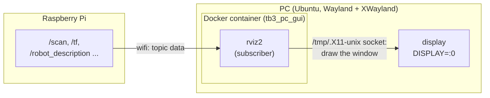

# Chapter 07: RViz inside Docker

> **Command tags:** `[Pi]` = SSH session on the robot, `[PC]` = normal PC terminal,
> `[PC-container]` = inside the Docker container on the PC.

## Goal

Open **RViz**, ROS's 3D visualisation window, from inside the Docker container, so that it
appears on your PC's screen and shows data coming from the robot.

## ROS concepts in this chapter

| Concept | What it is here | How to see it yourself |
|---------|-----------------|------------------------|
| **RViz2 is just a node** | It is not special. It subscribes to topics (`/scan`, `/tf`, `/robot_description` and later `/map`) and draws them | `ros2 node list` while RViz is open |
| **Launch file with a saved layout** | `rviz2.launch.py` starts RViz with a layout file that already has the robot model, TF and scan displays set up | `ros2 launch turtlebot3_bringup rviz2.launch.py` |
| **Displays and the Fixed Frame** *(preview)* | Each item in RViz's left panel is a display tied to a topic. The Fixed Frame is the coordinate frame everything is drawn relative to. Chapter 08 depends on this | The panel on the left of RViz |
| **Parameters: `use_sim_time`** | A setting on a node that says "use the simulator's clock instead of the real one". Use it only with a simulator | `ros2 param get /rviz use_sim_time` |

The Docker part is plain Linux, not ROS: a container has no screen of its own, so we let it
borrow the PC's display.

## Before you start

- [ ] Chapter 03 is done: you have the image `tb3_pc_image`
- [ ] Chapter 05 is done: the container can see the robot's topics
- [ ] Robot software is running on the Pi (Chapter 04)

## Steps

### Step 7.1: Understand how a container can show a window

Linux programs draw windows by talking to a **display server**. The container does not have one,
so we give it two things:

1. The **address** of the PC's display, in the `DISPLAY` environment variable.
2. The **socket file** that the display server listens on, `/tmp/.X11-unix`.

Check what your PC uses:

```bash
# [PC]
echo $DISPLAY
echo $XDG_SESSION_TYPE
```

Mine printed:

```text
:0
wayland
```

Ubuntu 24.04 uses **Wayland** by default, but it also runs a compatibility layer called
XWayland, which still answers on `DISPLAY=:0`. That is what the container talks to.

### Step 7.2: Allow containers to use the display

By default the display server refuses connections from other users, and Docker counts as another
user. This command lets local Docker containers in:

```bash
# [PC]
xhost +local:docker
```

**You should see** a message saying that `non-network local connections being added to access control list`

> **You will probably have to run this again.** I ended up running it in three separate
> sessions. I believe the permission is lost when you log out or reboot, so make it the first
> command of every session. To take the permission away again, run `xhost -local:docker`.

### Step 7.3: Create a container that can show windows

This is the command, run **once** to create the container. It starts from the image you made
in [Chapter 03](docs/03-docker-on-the-pc.md).

```bash
# [PC]
docker run -it --network host --name tb3_pc_gui \
  -e DISPLAY=$DISPLAY \
  -v /tmp/.X11-unix:/tmp/.X11-unix:rw \
  tb3_pc_image bash
```

| Part | Meaning |
|------|---------|
| `--network host` | Same as before: share the PC's network, so the container can see the robot |
| `--name tb3_pc_gui` | The container's name |
| `-e DISPLAY=$DISPLAY` | Pass the display address into the container |
| `-v /tmp/.X11-unix:/tmp/.X11-unix:rw` | Share the display socket with the container |
| `tb3_pc_image` | The image from Chapter 03, with the TurtleBot3 packages |

Afterwards you **do not** run this command again. If you do, Docker will complain that the name
is already in use. Use `docker start` and `docker exec` instead (Step 7.6).

To check how the container was set up, run this on the PC:

```bash
# [PC]
docker inspect tb3_pc_gui --format 'Network: {{.HostConfig.NetworkMode}}
Binds: {{.HostConfig.Binds}}
Env: {{.Config.Env}}'
```

Mine showed `Network: host`, the X11 folder bound in, and `DISPLAY=:0` in the environment.

### Step 7.4: Test with RViz on its own

Inside the container you just created:

```bash
# [PC-container]
source /opt/ros/humble/setup.bash
rviz2
```

**You should see** an empty RViz window open on your PC screen. Close it. If it does not open,
see [When it broke](#when-it-broke).

### Step 7.5: Open RViz with the robot's layout

With the robot software running on the Pi:

```bash
# [PC-container]
ros2 launch turtlebot3_bringup rviz2.launch.py
```

**You should see** RViz open with the robot model, the TF frames, and the lidar scan as dots.
The panel on the left may show red or yellow warnings on some displays. That is expected at this
stage, and decoding them is the subject of [Chapter 08](08-no-transform-and-the-clock.md).

> **Do not set `use_sim_time:=true` with the real robot.** If you have used a simulator before,
> you may have commands in your history that do. On a real robot that setting makes nodes wait
> for a simulated clock that never arrives.

Here is how the pieces connect:



### Step 7.6: Everyday use of the GUI container

```bash
# [PC]
xhost +local:docker
docker start tb3_pc_gui
docker exec -it tb3_pc_gui bash
```

Every extra terminal you need inside the container is another `docker exec -it tb3_pc_gui bash`.
These shells inherit `DISPLAY` from the container, so GUI programs work in all of them.

### Step 7.7 (optional): One command for all of that

The file [`scripts/start-gui-container.sh`](../scripts/start-gui-container.sh) in this repo does
Step 7.6, and creates the container if it does not exist yet. Run it with:

```bash
# [PC]
bash scripts/start-gui-container.sh
```

> **Untested:** I wrote this script after the fact. I used the manual commands above. Read it
> before you run it, and check that it works on your machine.

## Checklist

- [ ] `echo $DISPLAY` prints something like `:0`
- [ ] `xhost +local:docker` reports that access is allowed
- [ ] `tb3_pc_gui` exists (`docker ps -a`) and was created with the display variable and socket
- [ ] `rviz2` opens a window on your PC screen
- [ ] `ros2 launch turtlebot3_bringup rviz2.launch.py` shows the robot and the scan
- [ ] You can explain why the container needs `DISPLAY` and the X11 socket

## When it broke

### Case 1: mistakes in long commands

| | |
|---|---|
| **Symptom** | A long `docker run` command failed, so I had to retype it |
| **What it really was** | Typing mistakes in two different commands. In one, I had written `--networkhost` without a space. In the other, a space slipped into the path, giving `-v /tmp/ .X11-unix:...` |
| **Fix** | Retype carefully. Check each part of the command against the table in Step 7.3 |
| **Lesson** | Long commands are easy to mistype. Copy and paste them, or put them in a script (Step 7.7) |

### Case 2: no window opens

I did not hit this myself, so this is general guidance for readers:

| Symptom | Likely cause | What to check |
|---------|--------------|---------------|
| `cannot connect to X server` or `could not connect to display` | Permission not granted | Run `xhost +local:docker` on the PC and try again |
| Same, even after `xhost` | Container has no display address | `docker inspect` should show `DISPLAY=...`. If not, recreate the container with Step 7.3 |
| Window opens but is black or flickers | Graphics driver trouble inside the container | Try again after closing other GUI programs, and check for error lines in the terminal |
| RViz opens but no robot data | Same causes as Chapter 05 | Run `ros2 topic list` in the container |

## Recap

- You gave a container access to the PC's display with `DISPLAY`, the X11 socket and `xhost`.
- You saw that **RViz is a subscriber node**, like any other.
- You opened RViz with the TurtleBot3 layout and saw the robot's data.
- Next: make sense of the red warnings, the "No transform" problem.

## Try it yourself (optional)

With RViz open, run `ros2 node list` and `ros2 topic info /scan -v` in another container terminal.
Can you find RViz in the subscriber list for `/scan`?
