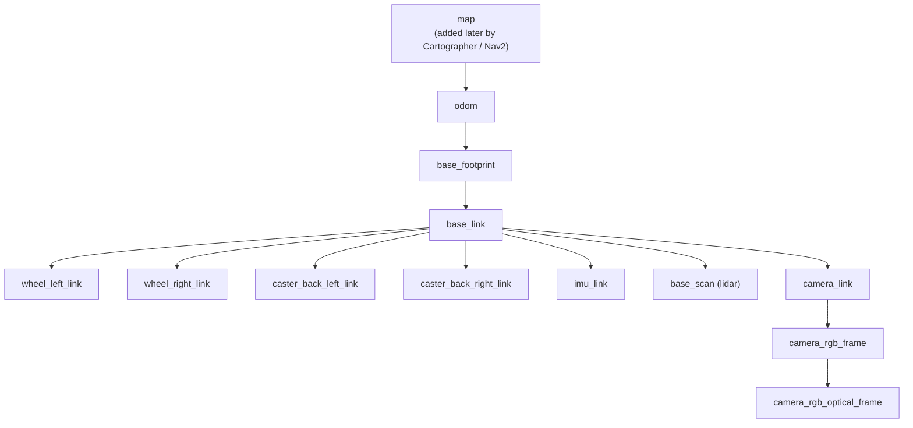

# Chapter 08: Debug case, "No transform" and the clock that was 195 days off

> **Command tags:** `[Pi]` = SSH session on the robot, `[PC]` = normal PC terminal,
> `[PC-container]` = inside the Docker container on the PC.

## Goal

Work out why RViz and mapping tools complained about missing transforms even though the robot
was publishing data, and learn a method for chasing this kind of problem: **guess, measure,
then fix**.

This chapter is mostly about **finding** the cause. The fix is in
[Chapter 09](09-time-sync-without-internet.md).

## ROS concepts in this chapter

| Concept | What it is here | How to see it yourself |
|---------|-----------------|------------------------|
| **Frame** | A named coordinate system attached to something: `odom`, `base_footprint`, `base_scan` (the lidar), `wheel_left_link` and so on | `ros2 run tf2_ros tf2_monitor` lists them |
| **Transform (TF)** | "Where is frame A relative to frame B?" as a position plus a rotation | `ros2 topic echo /tf --once` |
| **TF tree** | All frames, linked parent to child. To convert a lidar point into the map, ROS follows the chain of transforms | the diagram in Step 8.4 |
| **`/tf` and `/tf_static`** | `/tf` carries transforms that change (wheels turning, the robot moving). `/tf_static` carries fixed ones (the lidar is bolted to the robot) | `ros2 topic list \| grep tf` |
| **Timestamp** | Every transform carries the time it was valid for, in its `header.stamp`. Tools compare it with **their own clock** | `ros2 topic echo /tf --once` |
| **Clock** | Each machine has its own. ROS does not synchronise them for you | `date` |

The key point of this chapter: TF is not only about **where** things are, but **when**. A
transform that claims to be from 195 days ago is useless to a tool that wants to know where the
robot is *now*.

## The story in one table

| | |
|---|---|
| **Symptom** | RViz's TF display said `No transform from [base_footprint] to [imu_link]`, and the same for every other robot frame, while `map` and `odom` were fine (see the photo in Step 8.1) |
| **What I thought it was** | Wifi **packet loss**. `/tf` is a fast topic, and I suspected some messages never reached the PC |
| **How I tested it** | Measured the `/tf` rate on the Pi and on the PC at the same time (Step 8.2) |
| **Result** | Both machines saw about 32 messages per second, so the data was arriving. My first guess was **wrong** |
| **What it really was** | The Pi's clock was **about 195 days behind** the PC's clock (Steps 8.3 and 8.4) |
| **Fix** | Make the two clocks agree. See Chapter 09 |
| **Lesson** | When ROS complains about transforms, run `date` on both machines before touching anything else |

## Steps

### Step 8.1: Look at the symptom

With bringup running on the Pi and RViz open in the container (Chapter 07), look at the left
panel. Displays that depend on transforms show a warning or error status, and some frames are
missing or greyed out.

   ![Photo of RViz's TF display: map and odom say "Transform OK", every other frame says "No transform from [frame] to [map]"](../assets/08-rviz-no-transform.jpeg)

   *A photo of my monitor (hence the angle and glare), showing RViz opened by the Cartographer launch, with the Fixed Frame set to `map`.*

   Reading it as text:

```text
   map                          Transform OK
   odom                         Transform OK
   base_footprint               No transform from [base_footprint] to [map]
   base_link                    No transform from [base_link] to [map]
   base_scan                    No transform from [base_scan] to [map]
   camera_link                  No transform from [camera_link] to [map]
   camera_rgb_frame             No transform from [camera_rgb_frame] to [map]
   camera_rgb_optical_frame     No transform from [camera_rgb_optical_frame] to [map]
   caster_back_left_link        No transform from [caster_back_left_link] to [map]
   caster_back_right_link       No transform from [caster_back_right_link] to [map]
   imu_link                     No transform from [imu_link] to [map]
   wheel_left_link              No transform from [wheel_left_link] to [map]
   wheel_right_link             No transform from [wheel_right_link] to [map]
```

   Notice the pattern: `map` and `odom` come from the PC and are fine, while every frame
   published by the robot fails. That fits two machines disagreeing about the time, but the
   message itself never says "clock". The same message also appears when nothing publishes
   `map → odom` at all, so you have to measure.

### Step 8.2: Test the first guess (packet loss)

If wifi were dropping `/tf` messages, the PC would receive fewer per second than the Pi sends.
Measure both at the same time:

```bash
# [PC-container]
source /opt/ros/humble/setup.bash
ros2 topic hz /tf
```

```bash
# [Pi]  another SSH window
source /opt/ros/humble/setup.bash
ros2 topic hz /tf
```

Let both run for about 20 seconds, then stop them with `Ctrl+C`.

**What I saw:** an average rate of about **32 Hz on both machines**.

The PC received as many messages as the Pi was sending, so there was no meaningful packet loss.
**The guess was wrong**, and it is better to find that out in one minute with a measurement than
to spend an afternoon changing wifi settings.

### Step 8.3: Compare the clocks

The data was arriving, so something else was wrong with it. One more candidate: the timestamps.
Run `date` on both machines, one right after the other:

```bash
# [Pi]
date
```

```bash
# [PC]
date
```

**What I saw:**

```text
Pi:  Tue Mar 24 10:44:37 PM +08 2026
PC:  Mon Oct  5 03:16:45 PM +08 2026
```

The Pi believed it was **24 March**. The PC knew it was **5 October**. That is a gap of roughly
195 days.

Why is the Pi so wrong? A Raspberry Pi has no battery-backed clock, and my lab router had no
internet, so nothing could tell it the real date. After every power cycle it starts from the
last time it remembers, or a default, and stays wrong. The wrong date was not the same each
time, which fits that explanation.

### Step 8.4: Measure the damage with `tf2_monitor`

`tf2_monitor` lists every frame and how old its latest transform is, according to the machine
you run it on:

```bash
# [PC-container]
source /opt/ros/humble/setup.bash
ros2 run tf2_ros tf2_monitor
```

Let it run for about 10 seconds, then press `Ctrl+C`. **What I saw** (shortened):

```text
Frame: base_footprint, published by <no authority available>, Average Delay: 1.68212e+07, Max Delay: 1.68212e+07
Frame: base_link, published by <no authority available>, Average Delay: 1.68225e+07, Max Delay: 1.68225e+07
Frame: base_scan, published by <no authority available>, Average Delay: 1.68225e+07, Max Delay: 1.68225e+07
Frame: camera_link, ...
Frame: imu_link, ...
Frame: wheel_left_link, published by <no authority available>, Average Delay: 1.68212e+07, Max Delay: 1.68212e+07
Frame: wheel_right_link, ...
All Broadcasters:
Node: <no authority available> 33.0751 Hz, Average Delay: 1.68212e+07
```

How to read it:

- **Average Delay** is in **seconds**. A healthy value is a fraction of a second.
- `1.68212e+07` is 16,821,200 seconds. Divide by 86,400 seconds in a day: **about 194.7 days**.
  This matches the gap between the two `date` outputs.
- **Every frame** has the same huge delay. When all frames are wrong by the same amount,
  look for **one** cause, not many.
- The broadcaster rate of about **33 Hz** agrees with the `/tf` rate from Step 8.2. The data
  flowed fine. Only its timestamps were wrong.
- You can ignore `<no authority available>`. It is a quirk of the tool's output.

Here is the TF tree these frames belong to, with the part the robot publishes in the middle:



> The tree is drawn from the TurtleBot3 model and the frame names above. To draw your own,
> run `ros2 run tf2_tools view_frames` in the container, which saves a `frames.pdf`. I have
> not tried that on my setup.

### Step 8.5: Why a wrong clock breaks TF

Every transform is stamped with the time it was valid. Tools such as RViz, Cartographer and
Nav2 ask questions like "where was the lidar, relative to the map, at this moment?" They
compare timestamps with **their own clock** and keep only a short history of transforms.

Here, the robot stamped everything with the Pi's clock (March), while the PC compared it with
its own (October). From the PC's point of view, the transforms were from half a year ago:
out of date, not usable for "now". Anything that mixes timestamps from **two machines** needs
the two clocks to agree. The same thing happens, in a milder form, when the clocks are off by
only a few seconds.

Nothing in ROS warned that the clocks disagreed. The only visible sign was the transform
warnings, which is why this was so confusing.

### Step 8.6: What comes next

The cause is known: the Pi's clock. Chapter 09 fixes it, first by hand, which turns out to be
trickier than it sounds, and then properly, with a time server on your PC that needs no internet.

## Checklist

- [ ] `ros2 topic hz /tf` shows a similar rate on the Pi and on the PC
- [ ] `date` on the Pi and on the PC agree to within about a second
- [ ] `tf2_monitor` shows an average delay well under a second for the frames that move
- [ ] You can explain what a frame, a transform and a timestamp are
- [ ] You can explain why clocks on different machines matter to ROS

## What to check when you see transform warnings

| Step | Command | If this is wrong |
|------|---------|------------------|
| 1. Are the TF messages arriving? | `ros2 topic hz /tf` on both machines | Network problem: go back to Chapter 05 |
| 2. Do the clocks agree? | `date` on both machines | Clock problem: Chapter 09 |
| 3. How old are the transforms? | `ros2 run tf2_ros tf2_monitor` | A delay much larger than a second points to the clocks |
| 4. Is something else broken? | Nodes running? Frame names correct? Fixed Frame set correctly in RViz? | Look at the node and frame names |

## Recap

- You tested a plausible guess (packet loss) with a measurement, and found it was wrong.
- You found the real cause by comparing clocks: the Pi was about 195 days behind the PC.
- You learned that TF depends on **time** as well as position, and that ROS does not synchronise the clocks of your machines.
- Next: fix the clock, and then fix it properly.

## Try it yourself (optional)

Run `ros2 topic echo /tf --once` in the container and find a `stamp` with `sec` and `nanosec`
fields. Compare the `sec` value with `date +%s` on the PC, which prints the current time in
the same unit. How far apart are they? I have not done this comparison on my setup, so check
that you understand the units before drawing a conclusion.
