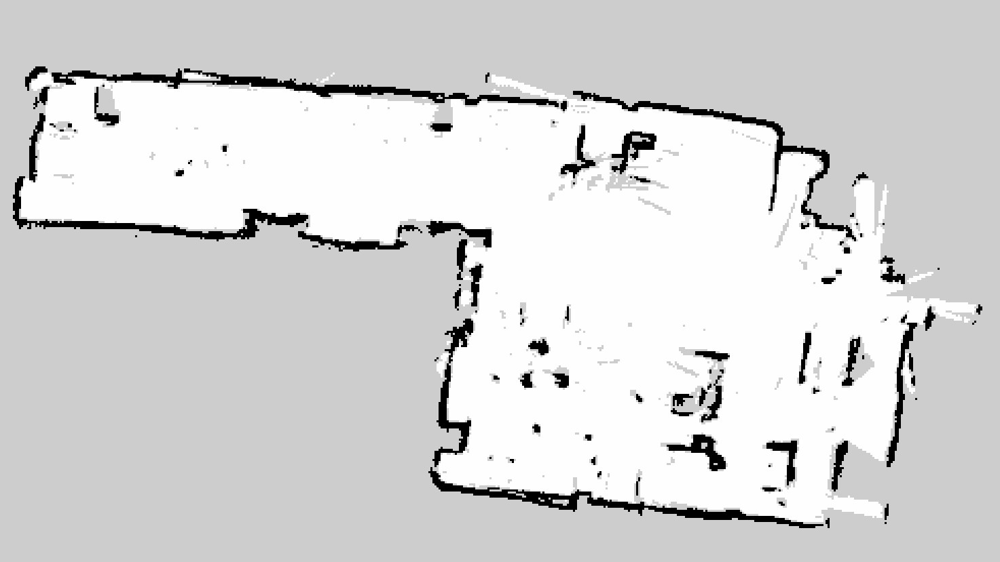

# Chapter 11: Saving the map

> **Command tags:** `[Pi]` = SSH session on the robot, `[PC]` = normal PC terminal,
> `[PC-container]` = inside the Docker container on the PC.

## Goal

Write the map that Cartographer built to files on disk, so you can use it later with Nav2
even after Cartographer is closed, and make a backup outside the container.

## ROS concepts in this chapter

| Concept | What it is here | How to see it yourself |
|---------|-----------------|------------------------|
| **`ros2 run`** | Runs **one program** (a node) by name, unlike `ros2 launch`, which starts a whole set. The map saver is a one-shot node: it starts, receives the map, writes the files, and exits | `ros2 run nav2_map_server map_saver_cli ...` |
| **Subscriber with a late join** | The map saver starts long after Cartographer published the map. By default it asks for *Transient Local* delivery, which is why it still receives the latest map (see Chapter 10, Step 10.4) | `ros2 topic info /map -v` while it runs |
| **`OccupancyGrid` to files** | The `/map` message is turned into two files: an **image** (`.pgm`) and a **description** (`.yaml`) | `ls -l /root/maps` |
| **Services** *(preview)* | Besides this command-line tool, Nav2 also offers a map saver that works by **service**: a request-and-reply call to a node, instead of a stream of messages. Chapter 12 shows services in action | `ros2 service list` |

## Before you start

- [ ] Chapter 10 is done, and you have a map you are happy with in RViz
- [ ] Cartographer is **still running**, and the robot software is still running
- [ ] You know which container you work in (I used `tb3_pc_gui`)

## Steps

### Step 11.1: Do not close Cartographer yet

The map only exists as the `/map` topic while Cartographer runs. If you stop Cartographer first,
there is nothing left to save. Keep it running, and open a second terminal in the container:

```bash
# [PC]
docker exec -it tb3_pc_gui bash
```

### Step 11.2: Save the map

```bash
# [PC-container]
source /opt/ros/humble/setup.bash
mkdir -p /root/maps
ros2 run nav2_map_server map_saver_cli -f /root/maps/lab_map
```

`-f` gives the file name **without an extension**. The tool adds `.pgm` and `.yaml` itself.

The first time, I saved a rough map under a different name (`rough_map`) so I could test Nav2
straight away, and I built a full map later. Giving each map its own name means a new save never
overwrites an old one.

> **Typical output.** The exact wording, numbers and timestamps differ between versions. Yours
> should end with a success message.

```text
[INFO] [map_saver]: Saving map from 'map' topic to '/root/maps/lab_map' file
[WARN] [map_saver]: Free threshold unspecified. Setting it to default value: 0.250000
[WARN] [map_saver]: Occupied threshold unspecified. Setting it to default value: 0.650000
[INFO] [map_saver]: Received a 160 X 120 map @ 0.05 m/pix
[INFO] [map_saver]: Writing map occupancy data to /root/maps/lab_map.pgm
[INFO] [map_saver]: Writing map metadata to /root/maps/lab_map.yaml
[INFO] [map_saver]: Map saved
```

The two `WARN` lines are normal. They only say the tool used its default thresholds.

### Step 11.3: Check the files exist

```bash
# [PC-container]
ls -l /root/maps
```

> **Typical output** (sizes and dates differ):

```text
-rw-r--r-- 1 root root  19215 Oct  6 15:02 lab_map.pgm
-rw-r--r-- 1 root root    130 Oct  6 15:02 lab_map.yaml
```

You should see both files, and the `.pgm` should be much larger than the `.yaml`.

### Step 11.4: Read the description file

```bash
# [PC-container]
cat /root/maps/lab_map.yaml
```

> **Typical contents** (the `origin` and the name differ for every map):

```yaml
image: lab_map.pgm
mode: trinary
resolution: 0.05
origin: [-4.2, -3.1, 0]
negate: 0
occupied_thresh: 0.65
free_thresh: 0.25
```

| Line | Meaning |
|------|---------|
| `image` | The picture file, **relative to this yaml file**. Keep the two files in the same folder |
| `mode: trinary` | Each cell becomes one of three things: occupied, free or unknown |
| `resolution` | Metres per pixel. `0.05` means each pixel is 5 cm |
| `origin` | Where the **bottom-left pixel** of the image sits in the `map` frame, in metres. The `map` frame's own origin is wherever Cartographer started, which matters in Chapter 12 |
| `negate` | `0` means white is free and black is occupied |
| `occupied_thresh` | A cell counts as occupied if it is more than 65% likely to be |
| `free_thresh` | A cell counts as free if it is less than 25% likely to be occupied |

The `.pgm` file is an ordinary greyscale image. Black pixels (value `0`) are obstacles, white
pixels (value `254`) are free, and grey pixels (value `205`) are unknown.

### Step 11.5: Copy the map out of the container

A container's files stay inside it. If you ever delete the container, the map goes too.
Copy the whole folder to your PC:

```bash
# [PC]
docker cp tb3_pc_gui:/root/maps ~/tb3_maps
ls ~/tb3_maps
```

`docker cp` works whether the container is running or stopped.

### Step 11.6: Look at the saved map

Because a `.pgm` is just an image, you can convert it to a PNG and look at it, with no robot or
RViz involved:

```bash
# [PC]
sudo apt install imagemagick
convert ~/tb3_maps/lab_map.pgm -filter point -resize 300% lab_map.png
```

`-resize 300%` makes the small image bigger, and `-filter point` keeps the pixels sharp
instead of blurring them. Open `lab_map.png` to see your map.



*The saved map as an ordinary image. If you are sharing a map publicly, remember that it is a
floor plan of the place you mapped.*

### Step 11.7: Stop Cartographer

Now it is safe to stop. Press `Ctrl+C` in the Cartographer terminal. The map is saved.
In Chapter 12, Nav2 loads these two files instead.

## Checklist

- [ ] `map_saver_cli` ended with a success message
- [ ] `/root/maps` contains a `.pgm` and a `.yaml` with the same base name
- [ ] The yaml's `image:` line names the `.pgm` file, and both files are in the same folder
- [ ] You copied the maps out of the container to the PC
- [ ] You opened the map as an image and it looks like your room
- [ ] You know that `resolution` is metres per pixel, and that `origin` places the map in the `map` frame

## When it broke

Nothing broke when I saved the map. These are the mistakes I would watch for (general guidance,
not a record of my own failures):

| Symptom | Likely cause | What to check |
|---------|--------------|---------------|
| An error such as "Failed to spin map subscription" | No `/map` topic: Cartographer is not running, or you closed it first | Is Cartographer still running? `ros2 topic list` should show `/map` |
| The command cannot write the files | The folder does not exist, or the path is mistyped | `mkdir -p /root/maps`, and check the path after `-f` |
| The map is gone after a restart | It stayed inside a deleted container | Step 11.5: copy it to the PC |
| Nav2 later says it cannot load the map | The yaml's `image:` path does not match the `.pgm` file name, or the two files are in different folders | `cat` the yaml, and `ls` the folder |
| A new map replaced an old one | Same file name used twice | Give every map its own name (for example a date or a place) |

## Recap

- You saved the map with a one-shot node (`ros2 run`), which received it from the `/map` topic because of the *Transient Local* setting you met in Chapter 10.
- You turned an `OccupancyGrid` message into a picture (`.pgm`) and a description (`.yaml`).
- You learned how to read the yaml, especially `resolution` and `origin`.
- You backed the map up outside the container.
- Next: give the map to Nav2 and make the robot drive to goals by itself.

## Try it yourself (optional)

Open the `.pgm` in an image editor and find the grey pixels. What do they represent? Then use
the `resolution` from the yaml to work out the real size of your room: multiply the image width
in pixels by 0.05 to get metres.
