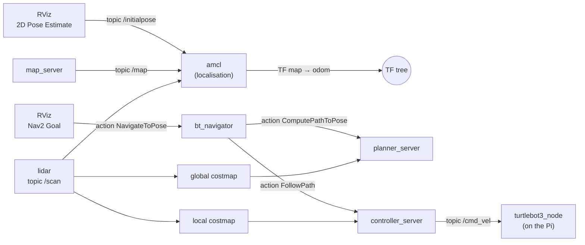
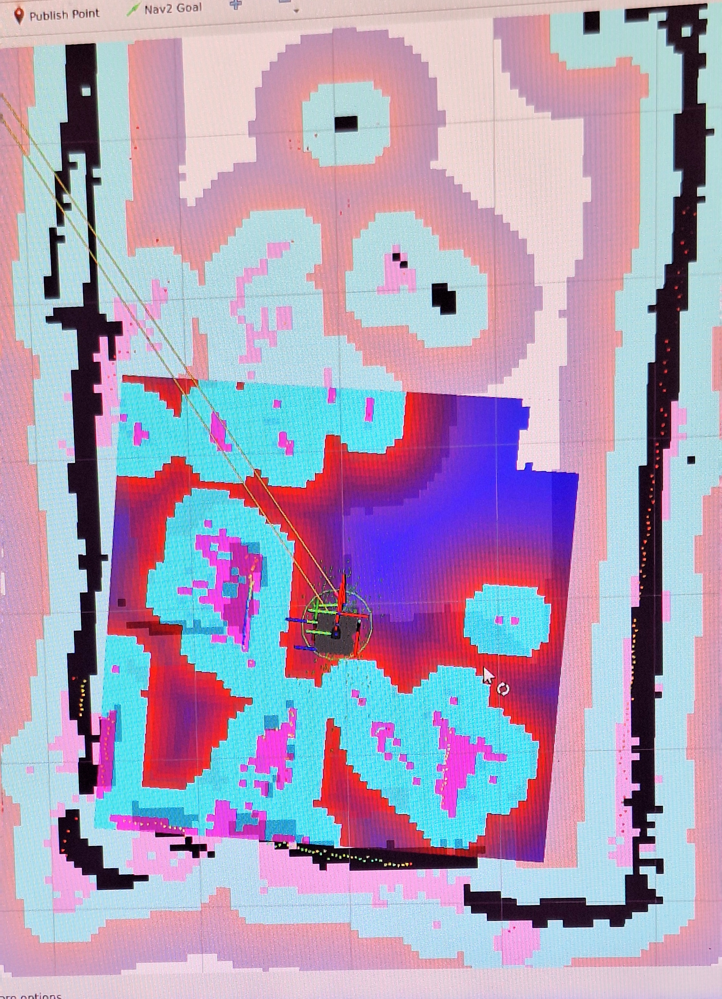
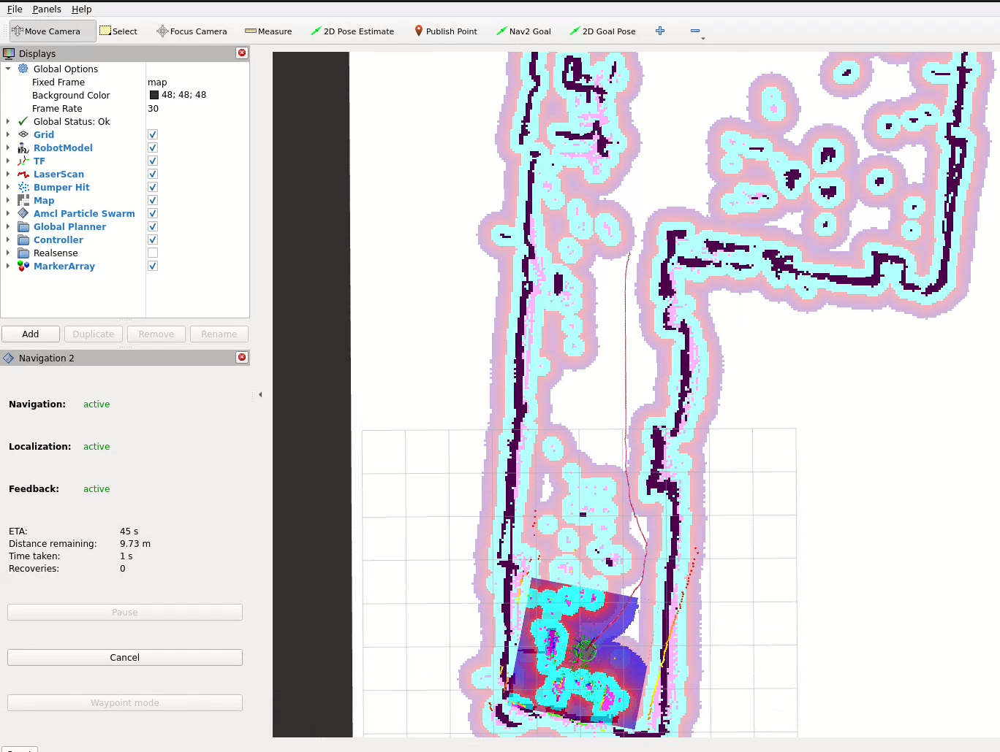
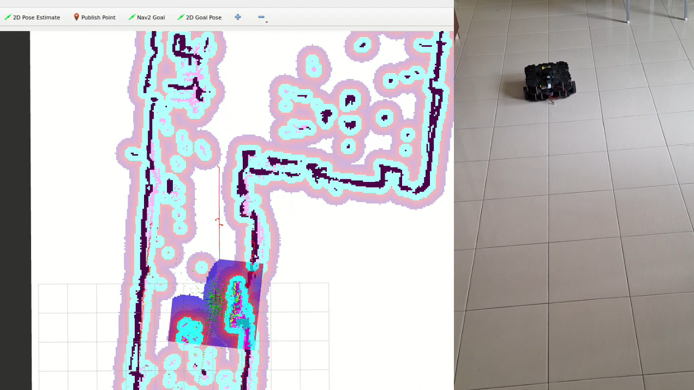

# Chapter 12: Navigating with Nav2

> **Command tags:** `[Pi]` = SSH session on the robot, `[PC]` = normal PC terminal,
> `[PC-container]` = inside the Docker container on the PC.

## Goal

Give Nav2 your saved map, tell it where the robot is, click a goal in RViz, and watch the robot
drive there by itself. This is also the chapter where **topics, services, actions, lifecycle
nodes and parameters** all show up together, so it is the best place to see how they differ.

## ROS concepts in this chapter

| Concept | What it is here | How to see it yourself |
|---------|-----------------|------------------------|
| **Topic** | A continuous stream: `/scan` (lidar), `/map`, `/cmd_vel`. Many receivers can listen | `ros2 topic list -t` |
| **Publisher / subscriber** | RViz **publishes** your initial pose on `/initialpose`, and `amcl` **subscribes** to it. The navigation software now publishes `/cmd_vel`, where teleop did in Chapter 06 | `ros2 topic info /initialpose -v` |
| **Action** | A **long-running request with progress updates**. Clicking *Nav2 Goal* sends a `NavigateToPose` goal. The robot reports feedback while it drives, can be cancelled, and sends a result at the end | `ros2 action list` |
| **Service** | A **quick question and answer** between two nodes, such as "clear the costmap now". One request, one reply | `ros2 service list -t` |
| **Lifecycle node** | A node with managed states (unconfigured, inactive, active). Nav2 uses them so that its parts start in the right order | the log line at the end of the launch |
| **Parameters** | Named settings on a node, loaded from a YAML file at launch. Chapter 12 only reads them. Tuning is out of scope for this guide | `ros2 param list /amcl` |
| **TF** | `amcl` now provides the `map → odom` transform. Cartographer did that in Chapter 10, which is why it must be stopped first | RViz's TF display |
| **Costmap** | A grid of "how bad is it to drive here" costs built from the map and the lidar | RViz's costmap displays |
| **QoS** | The map is published as *Transient Local* again (Chapter 10), so Nav2 nodes that start late still get it | `ros2 topic info /map -v` |

### Topic, service or action?

| | Topic | Service | Action |
|---|-------|---------|--------|
| **Pattern** | Broadcast a stream | Ask once, get one reply | Start a task, get updates, get a result |
| **Duration** | Continuous | Instant | Seconds to minutes |
| **Can you cancel?** | n/a | No | Yes |
| **Example here** | `/scan` | clear the costmap | `NavigateToPose` |

## Before you start

- [ ] Chapter 11 is done: you have a saved map (`.pgm` and `.yaml`) in `/root/maps` in the container
- [ ] The robot software is running on the Pi (Chapter 04)
- [ ] The Pi's clock is synced and `tf2_monitor` shows small delays (Chapter 09)
- [ ] The battery is well charged, and the robot is on the floor in the mapped area with clear space around it
- [ ] The GUI container works (Chapter 07), and you ran `xhost +local:docker` in this session
- [ ] **Cartographer is stopped.** Nav2's localisation also publishes `map → odom`, and two programs publishing the same transform conflict

## How the pieces fit together

This is a simplified picture of what runs, and who talks to whom:



In words: **AMCL** works out where the robot is on the map by comparing the lidar scan with the
map. When you give a goal, the **behaviour tree navigator** asks the **planner** for a route
across the map, then asks the **controller** to follow it. The controller looks at the **local
costmap** (built from the live lidar) to steer around things, and sends speed commands on
`/cmd_vel`, the same topic you used for teleop in Chapter 06.

## Steps

### Step 12.1: Stop Cartographer and check your map

If Cartographer is still running, press `Ctrl+C` in its terminal and close its RViz window.
Then check the map files:

```bash
# [PC-container]
ls /root/maps
```

You should see your `.pgm` and `.yaml`.

### Step 12.2: Launch Nav2 with your map

```bash
# [PC-container]
source /opt/ros/humble/setup.bash
export TURTLEBOT3_MODEL=waffle_pi
ros2 launch turtlebot3_navigation2 navigation2.launch.py map:=/root/maps/lab_map.yaml
```

Use the name of your own map. **You should see** RViz open (its title bar shows
`tb3_navigation2.rviz`) with your map. The launch normally ends with a message saying the
managed nodes are **active**. That is the lifecycle manager reporting that every Nav2 node is
configured and running.

`map:=...` is a **launch argument**: you pass the map file in on the command line, and the
launch file hands it to `map_server`.

> **Do not add `use_sim_time:=true`** with the real robot. That setting is for simulators.

### Step 12.3: Look inside Nav2

Open a second terminal in the container:

```bash
# [PC]
docker exec -it tb3_pc_gui bash
```

```bash
# [PC-container]
source /opt/ros/humble/setup.bash
ros2 node list
```

> **Typical output.** Your list may be slightly longer or shorter, depending on your version.

```text
/amcl
/bt_navigator
/behavior_server
/controller_server
/global_costmap/global_costmap
/lifecycle_manager_localization
/lifecycle_manager_navigation
/local_costmap/local_costmap
/map_server
/planner_server
/rviz2
/smoother_server
/waypoint_follower
```

| Node | Its job |
|------|---------|
| `/map_server` | Loads your `.yaml` and `.pgm`, and publishes the map on `/map` |
| `/amcl` | Localisation: estimates where the robot is on the map from the lidar scan |
| `/planner_server` | Plans a route from the robot to the goal across the map |
| `/controller_server` | Follows the route, steering around obstacles, and publishes speed commands |
| `/bt_navigator` | The coordinator. It receives your goal and calls the planner and controller in the right order |
| `/behavior_server` | Recovery moves such as spinning or backing up when the robot is stuck |
| `/smoother_server` | Smooths the planned route |
| `/waypoint_follower` | Drives through a list of goals (not used in this guide) |
| `/global_costmap/...`, `/local_costmap/...` | The two costmaps (see Step 12.6) |
| `/lifecycle_manager_...` | Bring the other nodes up in the right order (lifecycle) |

Now the topics:

```bash
# [PC-container]
ros2 topic list -t
```

> **Typical output, trimmed to the interesting ones:**

```text
/amcl_pose [geometry_msgs/msg/PoseWithCovarianceStamped]
/cmd_vel [geometry_msgs/msg/Twist]
/global_costmap/costmap [nav_msgs/msg/OccupancyGrid]
/initialpose [geometry_msgs/msg/PoseWithCovarianceStamped]
/local_costmap/costmap [nav_msgs/msg/OccupancyGrid]
/map [nav_msgs/msg/OccupancyGrid]
/particle_cloud [nav2_msgs/msg/ParticleCloud]
/plan [nav_msgs/msg/Path]
/scan [sensor_msgs/msg/LaserScan]
```

| Topic | Who publishes | Who listens |
|-------|---------------|-------------|
| `/map` | `map_server` | `amcl`, the global costmap, RViz |
| `/initialpose` | RViz (your *2D Pose Estimate* click) | `amcl` |
| `/amcl_pose` | `amcl` | anything that wants the robot's estimated position |
| `/particle_cloud` | `amcl` | RViz (the green arrows around the robot) |
| `/plan` | the planner | RViz (the planned route) |
| `/cmd_vel` | `controller_server` | `turtlebot3_node` on the Pi |

Notice `/cmd_vel`: it is the **same topic** as in Chapter 06, but the publisher is no longer
`teleop_keyboard`. The robot driver neither knows nor cares who sends the commands. That is the
publish/subscribe idea paying off.

### Step 12.4: Tell Nav2 where the robot is

AMCL does not know where the robot starts on the map. You have to tell it roughly.

1. In RViz's toolbar, click **2D Pose Estimate**.
2. Click on the map **where the robot physically is**, and **drag** the arrow in the direction
   the robot is facing. Release.

RViz **publishes** that pose on `/initialpose`, and `amcl` **subscribes** to it. AMCL then
scatters thousands of guesses ("particles") around that pose, which RViz shows as small green
arrows, and refines them using the lidar.

A tip about the map: the map's origin is **wherever Cartographer started**, not where the robot
is now. So you cannot assume the robot is at the centre of the map. Use the map's walls and the
live lidar dots to find your position. **Check that the lidar dots line up with the black walls
of the map.** If they do not, the pose is wrong: click *2D Pose Estimate* again.

<!--  -->


*A photo of my monitor just after setting the pose and rotating the robot with teleop from another terminal. The green particles will shrink from a spread out state after slowly rotating the robot. (See next section)
*

### Step 12.5: Help AMCL converge

Open a second container terminal and run teleop (Chapter 06):

```bash
# [PC-container]
source /opt/ros/humble/setup.bash
export TURTLEBOT3_MODEL=waffle_pi
ros2 run turtlebot3_teleop teleop_keyboard
```

Rotate the robot slowly in place a full turn or two, then move forward and back a little near
a wall or a corner. Stop with `s`. Watch the particle cloud (tiny green arrows) in RViz shrink to a tight clump.
Scans taken in an open area with nothing nearby give AMCL very little to work with, so move
near walls.

Then check AMCL's confidence with numbers:

```bash
# [PC-container]
ros2 topic echo /amcl_pose --once --field pose.covariance
```

You get 36 numbers, a 6×6 grid. Three of them matter: the first (uncertainty in x), the eighth
(y), and the last (rotation). They are **variances**: take the square root to get the real
uncertainty in metres or radians. **What I saw** after rotating and moving:

| | Variance | Square root |
|---|---------|-------------|
| x | 0.043 | about 0.21 m |
| y | 0.026 | about 0.16 m |
| rotation | 0.045 | about 0.21 rad (about 12°) |

That is an uncertainty of around 15 to 20 cm, and about 12° in heading. It is good enough for
a first goal on a rough map, but not tight. The zeros elsewhere in the grid are normal for a
robot that moves on a flat floor.

### Step 12.6: Send a goal

Click **Nav2 Goal** in RViz's toolbar. Click a spot in **clear, well-mapped open space** about
1 m away, and drag the arrow to choose the final heading.

Watch RViz:

- **The green line** is the planned route (`/plan`).
- **The coloured grid around the robot** is the **local costmap**, a small window that moves
  with the robot and is built from the live lidar. It is what the controller steers by.
- **The coloured halos around the walls in the whole map** are the **global costmap**. The
  planner uses it to keep routes away from walls. The halo is called *inflation*: cells near an
  obstacle get a higher cost, so the robot keeps its distance.
- In the default RViz colours, the planner prefers the bluer areas and avoids the red ones.
  The cyan and pink fringes beside black walls are too close to drive through.

> The local costmap's square may look **tilted** compared with the map's grid. That is normal:
> it is aligned with the `odom` frame, and the `map → odom` rotation that AMCL computed is not
> zero.

<!--  -->


*A photo of my monitor while Nav2 was running. The robot sits in the middle of the local
costmap (the tilted square). The coloured halos along the black walls are the global costmap.*

**Stay next to the robot** for the first runs. Keep a teleop terminal ready (press `s` to
stop), and be ready to press `Ctrl+C` in the Nav2 terminal.

When a short goal works, repeat with:

1. A **longer goal** across the room.
2. A goal **behind the robot**, which requires it to turn around first.

These two are a good test of the whole system.

   ### Watch it happen

   <!-- [](https://youtu.be/<VIDEO_ID>) -->

  <a href="https://drive.google.com/file/d/1kAuPTwCIGlcb8W9VbeIHVOV4YL6y8oJP/view?usp=sharing" target="_blank">
  
  </a>

   *Side by side: RViz on the left, the real robot on the right. Click to watch on YouTube.*

   What happens, and when:

   - 0:00 `fill in`
   - 0:xx `fill in`

### Step 12.7: See the action behind the click

The *Nav2 Goal* button sends an **action goal**. List the actions:

```bash
# [PC-container]
ros2 action list
```

> **Typical output** (yours may list a few more):

```text
/compute_path_to_pose
/follow_path
/navigate_to_pose
/spin
/backup
/wait
```

`/navigate_to_pose` is what RViz's button uses. Inside, the navigator uses `/compute_path_to_pose`
(the planner) and `/follow_path` (the controller). The others are recovery moves.

```bash
# [PC-container]
ros2 action info /navigate_to_pose
```

It shows one action server (`bt_navigator`) and, while RViz is connected, an action client.

**Optional: be the client yourself.** The command below sends a goal from the command line.
It asks the robot to go to a point 1 m along the map's x axis, and prints feedback while it
drives. **Stay next to the robot**, and make sure there is clear space in that direction on your
map first:

```bash
# [PC-container]
ros2 action send_goal /navigate_to_pose nav2_msgs/action/NavigateToPose \
  "{pose: {header: {frame_id: map}, pose: {position: {x: 1.0, y: 0.0}, orientation: {w: 1.0}}}}" \
  --feedback
```

> I have not run this command on my robot. The numbers are map coordinates, so pick a spot you
> know is free. You should see feedback messages (including a remaining distance) while the
> robot drives, and a result at the end.

### Step 12.8 (optional): Services and parameters

**Services.** List them:

```bash
# [PC-container]
ros2 service list -t | grep -E "clear|reinitialize"
```

> **Typical output** (a few of many):

```text
/global_costmap/clear_entirely_global_costmap [nav2_msgs/srv/ClearEntireCostmap]
/local_costmap/clear_entirely_local_costmap [nav2_msgs/srv/ClearEntireCostmap]
/reinitialize_global_localization [std_srvs/srv/Empty]
```

Clearing the local costmap is a quick question and answer: one call, one reply, no progress to
report. That is what makes it a service rather than an action:

```bash
# [PC-container]
ros2 service call /local_costmap/clear_entirely_local_costmap nav2_msgs/srv/ClearEntireCostmap "{}"
```

> Not run on my robot. It is safe, because it only erases the costmap's memory of obstacles,
> and the robot rebuilds it from the next scans.

**Parameters.** Every Nav2 node has settings, loaded from a YAML file when you launched:

```bash
# [PC-container]
ros2 param list /amcl
ros2 param get /amcl max_particles
```

`max_particles` is how many guesses AMCL keeps. Look, but do not change anything now: tuning is
outside this guide.

## Checklist

- [ ] Cartographer is stopped, and `ros2 launch turtlebot3_navigation2 navigation2.launch.py map:=...` ran
- [ ] RViz shows your saved map and the robot
- [ ] After *2D Pose Estimate*, the lidar dots line up with the black walls
- [ ] After rotating, the particle cloud is tight and the covariance is small
- [ ] A short goal works: a planned route appears and the robot drives to it
- [ ] A longer goal, and a goal behind the robot, both work
- [ ] You can explain the difference between a topic, a service and an action, with an example of each from this chapter

## When it broke

My first Nav2 run did not go smoothly. The robot managed short goals but wobbled, refused long
goals, and could not turn around for a goal behind it. After a full restart and a short charge it
worked smoothly everywhere. That episode is the subject of [Chapter 13](13-wobbly-navigation-and-the-preflight-checklist.md).

If Nav2 misbehaves for you, here is a first checklist (general guidance):

| Symptom | Likely cause | What to check |
|---------|--------------|---------------|
| Map or robot missing in RViz, or warnings about transforms | Clocks differ, or Cartographer is still running | Chapter 09, and stop Cartographer |
| The lidar dots do not match the walls | Wrong initial pose | Click *2D Pose Estimate* again, using the walls to place it |
| The particle cloud stays wide | Not enough movement, or the robot is in an open area | Rotate in place near a wall |
| The robot ignores goals | Goal in unknown or blocked space, or the robot is not localised | Pick a goal in clear white map space, and check localisation first |
| The robot wobbles or stalls | Weak battery, power problems, or a stale state | Chapter 13 |

## Recap

- You gave Nav2 a saved map and told it where the robot is, by publishing `/initialpose`.
- You sent a goal, which is an **action** (`NavigateToPose`) with progress and a result.
- You saw **topics** (`/scan`, `/map`, `/cmd_vel`), **services** (clear the costmap), **lifecycle nodes** (the managers) and **parameters** (`max_particles`) in one running system.
- You saw the same `/cmd_vel` topic you used for teleop, now published by software.
- Next: why my first run went badly, and the checklist I now use before every session.

## Try it yourself (optional)

While the robot drives to a goal, run `ros2 topic echo /cmd_vel` in another terminal. Who is
publishing now? Then cancel the goal in RViz and watch the topic. What do the messages show once
the robot has stopped?
