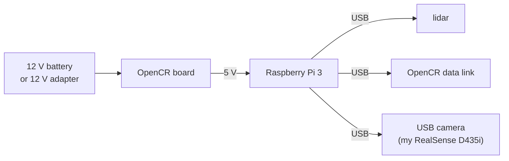

# Appendix D: Power and undervoltage

> **Command tags:** `[Pi]` = SSH session on the robot, `[PC]` = normal PC terminal,
> `[PC-container]` = inside the Docker container on the PC.

The Pi's console warned about **under-voltage** from my very first inspection, and it kept coming
back in different forms for weeks. One cause was finally found and fixed. Another was never
explained. This appendix tells both stories, including what I do **not** know.

## The short version

| | Episode 1: the early warning | Episode 2: the warning with the camera |
|---|-----------------------------|----------------------------------------|
| **When** | From the first inspection, before the RealSense camera was added | While adding a RealSense D435i depth camera |
| **What I saw** | `hwmon hwmon1: Undervoltage detected!` repeating on the Pi's console | The same warning flickering, camera USB resets, and a camera node that would not start |
| **What I tried** | Connecting both the battery and the 12 V adapter to the OpenCR, and a troubleshooting checklist | Measuring the OpenCR's 5 V output, powering the Pi from a power bank and then from a phone adapter, and finally swapping the camera's USB cable |
| **Result** | Not resolved. On a later check it did not reproduce, and the battery read 12.39 V, but I never confirmed a cause | **Fixed** by using the original USB 3 cable between the Pi and the camera |
| **Status** | **Unexplained** | **Solved** |

## How power reaches the Pi



In this layout the Pi gets its 5 V from the OpenCR board, and it also supplies 5 V to everything
plugged into its USB ports. That means **anything you add to the Pi's USB ports draws from the
same small supply**, and the cable between them is part of the power path.

The Pi watches its own 5 V supply. When the voltage dips too low, even briefly, it prints the
under-voltage warning and may slow itself down (throttling). I believe the threshold is about
4.63 V, but check the Raspberry Pi documentation for your model.

## Your power toolkit

**1. The Pi's own record:**

```bash
# [Pi]
vcgencmd get_throttled
sudo dmesg | grep -i -E "under-?voltage" | tail
```

`get_throttled` prints a code, and `0x0` means all is well. The meaning of each bit is in the table
in [Chapter 13](13-wobbly-navigation-and-the-preflight-checklist.md#step-132-your-diagnostic-toolkit).
The "has occurred" bits stay set until the next reboot, so after a change, **reboot before you
read it again**, or you will be reading old history.

The codes I actually saw:

| Code | Bits set | Meaning |
|------|----------|---------|
| `0x50005` | 0, 2, 16, 18 | Under-voltage **right now**, throttled **right now**, and both have also happened since boot |
| `0x50000` | 16, 18 | Under-voltage and throttling **have happened** since boot, but not at this moment |
| `0x80000` | 19 | Only the soft temperature limit has been reached. **No power problem** |

**2. The battery:**

```bash
# [PC-container]
ros2 topic echo /battery_state --once --field voltage
```

My battery read **12.39 V** on a healthy day. A good battery does not rule out a power problem
at the Pi, as the second episode shows.

**3. A multimeter**, measuring the 5 V supply. I measured **5.07 V** at the OpenCR's 5 V output.
That was fine, so the board itself was not the problem. Measuring at the Pi's end of the cable
while the robot is working would tell you more, because the voltage falls along the cable when
current flows.

## Episode 1: the early warning

During my first inspection (Chapter 01), the Pi's console repeatedly showed
`hwmon hwmon1: Undervoltage detected!`. This was **before** I added the RealSense camera.

What I did:

1. I noted it as a flag to deal with.
2. I connected **both** the 12 V battery and the 12 V 5 A adapter to the OpenCR. The warning
   persisted. I was given a checklist to go through: is the OpenCR switch and LED on, is the adapter in a
   working outlet, is the Pi's power cable fully seated?
3. I carried on with the software steps, because the warning was not stopping anything.

Later, on a check of the battery, it read a healthy 12.39 V, and the warning did **not**
reproduce. But I never found out what caused it, so I cannot say what made it go away.

**What I do not know:** whether it was a loose connection, the way the power was wired, a
momentary dip when the motors started, or something else. And I do not know whether it
contributed to the wobbly first Nav2 run in [Chapter 13](13-wobbly-navigation-and-the-preflight-checklist.md).
That run happened while this warning was still unexplained, so a power link is **possible but not
proven**.

## Episode 2: the warning with the camera

When I added the RealSense D435i, the under-voltage warnings came back, flickering, together with
repeated USB errors in `dmesg` (UVC `-71` errors and camera USB resets). The RealSense software
could see the camera on my PC, but on the Pi it reported that the requested device was not found.
At one point I decided to ignore the warning for the moment, which, looking back, was a
mistake, because the warning was pointing at the real problem.

I then tested one cause at a time:

| What I tried | Result |
|--------------|--------|
| Measure the OpenCR's 5 V output with a multimeter | 5.07 V: fine |
| Power the Pi through its micro-USB port from a **22.5 W power bank** | The warning **persisted** (`0x50005` / `0x50000`), and `dmesg` showed camera USB resets |
| Power the Pi from a **67 W phone adapter** | The warning **persisted** |
| Swap the camera's cable for the **original USB 3 cable** | **Fixed.** `get_throttled` showed `0x80000`, `dmesg` showed no under-voltage, and the RealSense node ran steadily |

So a stronger power source did nothing, and a better **cable** fixed it. The cable I had been using
was a phone-style charging cable.

**Why would a cable matter?** I do not know for certain. My best explanation is that a thin cable
has more electrical resistance, so when the camera draws current through it, the voltage at the
Pi's USB port sags below what it needs. I did not measure this, so treat it as a hypothesis.

## What this episode taught me

1. **A warning on the Pi is not always about the Pi's own supply.** A **peripheral** and its
   **cable** can pull the voltage down.
2. **Bigger is not always better.** Two stronger power sources changed nothing. The cheap thing
   (a cable) was the fix, and I should have tried the cheap things first.
3. **Test one change at a time.** Each row in the table above changed exactly one thing, which is
   why I could tell which one worked (the opposite of the Chapter 13 mistake).
4. **Do not ignore a warning that can corrupt data.** Under-voltage can cause random-looking
   failures, such as dropped USB devices or SD card trouble.
5. **Reboot before reading `get_throttled` again**, because the "has occurred" bits keep old
   history.

## Checklist: if you see under-voltage warnings

- [ ] Check the battery voltage (`/battery_state`) and that the OpenCR is not beeping
- [ ] Check every power connection is seated: battery or adapter, OpenCR, the cable to the Pi
- [ ] **Unplug USB devices one at a time** (camera, lidar) and see whether the warnings stop
- [ ] Swap the cable of the suspect device for a short, thick, **original** one
- [ ] Measure the 5 V supply with a multimeter if you have one
- [ ] Change **one thing** at a time, then **reboot** and read `get_throttled` again
- [ ] Write down what fixed it, and what did not

## Still unanswered

- What caused the warning in Episode 1, before the RealSense camera was connected?
- Was the wobbly first Nav2 run related to it?
- Is it really cable resistance that fixed Episode 2? A multimeter reading at the Pi's USB port, with
  each cable, would answer that.
